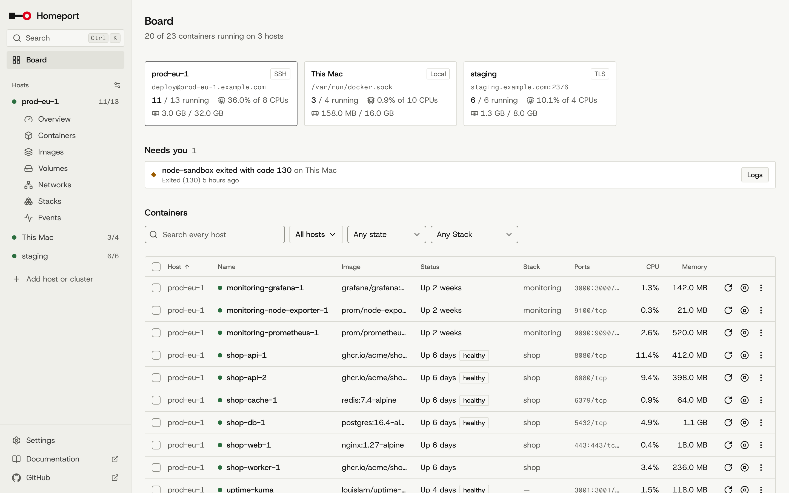

<h1>
  <picture>
    <source media="(prefers-color-scheme: dark)" srcset="assets/brand/lockup-dark.svg" />
    
  </picture>
</h1>

**One app for every container Engine.**

[Website](https://damienreichhart.github.io/homeport/) · [Documentation](https://damienreichhart.github.io/homeport/docs/) · [Download](https://damienreichhart.github.io/homeport/download/)

Homeport is a desktop app for Docker, Podman, containerd, Incus, Docker Swarm, Kubernetes and Nomad. It runs on your machine and reaches your servers over the connections you already have. Nothing is installed on a server or a cluster: no agent, no web panel, no account, no telemetry. Free and open source under the GNU AGPL, for Windows, macOS and Linux.

<picture>
  <source media="(prefers-color-scheme: dark)" srcset="website/src/assets/screenshots/board-dark.png" />
  
</picture>

## What it reaches

| Connection   | Reaches                                                                                                                       | What it needs on the server                                                                      |
| ------------ | ----------------------------------------------------------------------------------------------------------------------------- | ------------------------------------------------------------------------------------------------ |
| Local socket | Docker Desktop, OrbStack, Colima, Rancher Desktop and Podman machines on this computer, found for you                         | Nothing                                                                                          |
| SSH          | Docker Engine, Podman, containerd and Incus, through bastions if need be                                                      | The SSH port you already have open, and one line in `authorized_keys` for the key Homeport makes |
| TLS          | A Docker-compatible Engine's API, with your CA and client certificate                                                         | The Engine's API port (usually 2376), which you expose yourself                                  |
| TCP          | A Docker-compatible Engine's API, unencrypted                                                                                 | The Engine's API port (usually 2375); only on a network you trust                                |
| Cluster API  | Kubernetes from your kubeconfig (EKS, GKE and AKS included), Nomad by an agent's address, Incus over HTTPS with a trust token | The API the cluster already serves                                                               |

Every Engine is managed with the same words ([GLOSSARY.md](GLOSSARY.md)): a Host is a Host and a Stack is a Stack, whichever Engine runs it.

## Install

On Debian, Ubuntu, Fedora, RHEL and openSUSE, install it from the Homeport package repository, so `apt`, `dnf` or `zypper` keeps it up to date:

```sh
curl -fsSL https://damienreichhart.github.io/homeport/install.sh | sh
```

The [installation guide](https://damienreichhart.github.io/homeport/docs/installation/#manual-setup) shows the same setup step by step, without the script.

Installers for Windows 10 and 11 (x64 and ARM64), macOS 10.15 or later (Apple silicon and Intel) and Linux with glibc 2.35 or later, such as Ubuntu 22.04, Debian 12 and Fedora 36 (x64 and ARM64), are on the [download page](https://damienreichhart.github.io/homeport/download/) and the [releases page](https://github.com/DamienReichhart/homeport/releases/latest). Windows, macOS and AppImage installs update themselves from inside Homeport. Homebrew, winget, Scoop, the AUR, Flathub and Snap are planned after 1.0 ([#5 to #10](https://github.com/DamienReichhart/homeport/milestone/18)).

Pushing a new version to `main` publishes it; see [docs/RELEASING.md](docs/RELEASING.md).

## Features

Each area opens to its full description.

<details>
<summary><b>Overview and Board</b>: every Host and Cluster at once, what needs you first, every container in one table.</summary>

per-host and per-cluster cards, engine details, disk usage and clean-up, recent events, a cluster's Nodes, Pods, unready workloads and warnings; the Board lists the containers of every Host in one table, with filters and actions on a selection that spans Hosts.

</details>

<details>
<summary><b>Hosts</b>: local sockets found for you, SSH with its own key and bastions, mutual TLS, TCP; import from ~/.ssh/config and Docker contexts.</summary>

add local sockets (auto-detected: Docker Engine, Docker Desktop, Colima, OrbStack, Rancher Desktop, Podman, including each running Podman machine on macOS), TCP, mutual TLS and SSH. SSH Hosts get their own Ed25519 key with a copy-paste command to authorize it, can be reached through one or more bastions (`ProxyJump`), and every server's key is trusted on first use. Import Hosts from `~/.ssh/config` (keys and `ProxyJump` included) and from Docker contexts (TLS certificates included), and move them to another computer in a passphrase-protected export file. Status, reconnection with backoff, and a live event stream per Host whose history is kept across restarts.

</details>

<details>
<summary><b>Containers</b>: grouped by Stack, with live usage, logs, terminals, files, stats and a Run dialog.</summary>

grouped by Stack, marked when a newer image is published, live CPU/memory, lifecycle and bulk actions, logs (follow, search, download), inspect, interactive terminals, file browser with upload/download, stats charts, processes, and a Run dialog.

</details>

<details>
<summary><b>Stacks</b>: Managed, Linked, Synced and External Compose Stacks, with a diff before every redeploy and a history to roll back to.</summary>

every Compose project on a Host. Managed Stacks keep their YAML and encrypted environment in Homeport and deploy through the `docker compose` CLI; Linked Stacks are project folders on this computer, found from their compose labels or picked by hand, edited in place and deployed from the folder, builds included; Synced Stacks deploy a compose file from a git repository (a per-repository deploy key or a token, kept encrypted), show the new commits and the diff before each sync, and are checked for new commits while Homeport is open, with an optional auto-deploy (nothing syncs while it's closed); External Stacks can be started, stopped, removed or adopted. New Stacks start from templates; a Stack can combine several compose files and choose its Compose profiles; every redeploy shows what changes first, each deploy is kept in a history a Managed Stack can roll back to, and an "Update available" badge offers to pull newer images and redeploy in one step.

</details>

<details>
<summary><b>Images, Volumes, Networks</b>: pull, push, build, save and load images; size, browse, back up and clone volumes.</summary>

search Docker Hub and its tags, pull and push with progress and stored registry logins, build from a folder on this machine, save to and load from a tar file, tag, run, history, prune; each volume's size, a read-only file browser, backing a volume up to a tar file and restoring it, and cloning it, through a short-lived helper container that leaves nothing behind; volume and network usage, create, connect/disconnect, guarded deletion.

</details>

<details>
<summary><b>Swarms</b>: nodes, services, tasks, secrets, configs and swarm stacks, through any manager Host.</summary>

every Docker Swarm a Host belongs to, found through its manager Hosts (once each, by swarm ID) and managed through any connected one, with nothing installed on a node: nodes (drain, pause, promote, demote, labels, remove), services (create, scale, update image, environment and replicas, roll back, logs from every task), tasks with their errors, secrets and configs (a secret's value is sent once and never kept), and swarm stacks, External ones found by their namespace and removed like `docker stack rm`, and Managed, Linked and Synced Stacks deployed with `docker stack deploy`. Start a Swarm on a Host, join one or leave it, with the join token fetched from a manager.

</details>

<details>
<summary><b>Podman</b>: pods and Quadlet units, through Podman's own API.</summary>

a Podman Host is recognised on every connect and its status says so; the sidebar then adds what only Podman has, through Podman's own API on the same socket. **Pods**: list them with their containers, start, stop, restart, pause, resume and remove them, create one with its published ports and labels, and run a container into it from the Run dialog. **Quadlet units**: list them with their systemd status and the containers they created (from their containers' labels on Podman before 5.7), read, install with extra files, edit and remove them (Podman 5.8 and later), and start, stop and restart their services with `systemctl` over SSH or for a Podman on this computer, never with `sudo`. Docker Hosts see none of it.

</details>

<details>
<summary><b>containerd</b>: containerd 1.7+ on its socket or over SSH: namespaces, tasks, logs, a terminal, images and snapshots.</summary>

a Host's Engine can be containerd 1.7 or later, reached on its socket locally or over SSH (k3s's, Docker Engine's own, or containerd's service), through containerd's gRPC API with client code generated at build time, no `protoc` needed (ADR 0020). Pick its namespace under the Host switcher (remembered per Host); list containers with their tasks and which tool made them, start, stop (SIGKILL after a grace period), pause, resume, signal and remove them with or without their snapshot, with a warning on the kubelet's; read the logs nerdctl and Kubernetes wrote (and say plainly when `ctr` kept none) and open a terminal, both with `tail`, `mkfifo` and `cat` run over SSH, never `sudo`; list, pull (containerd 2.0's Transfer service, with your registry logins) and remove images; and browse snapshots by snapshotter with their usage and users, removing orphaned ones.

</details>

<details>
<summary><b>Incus</b>: Incus 6.0+ over its socket, SSH or HTTPS: instances, consoles, snapshots, images, profiles, storage and networks.</summary>

a Host's Engine can be Incus 6.0 or later, on its socket locally or over SSH (the admin socket, or the restricted one that reaches only your project), or over HTTPS by pasting a trust token from `incus config trust add`: Homeport makes its own client certificate in memory, pins Incus's self-signed certificate by fingerprint and registers itself (ADR 0021). Pick its project under the Host switcher (remembered per Host). **Instances**: system containers and virtual machines with their state, addresses and usage; start, stop (gracefully or by force), restart, freeze and delete them, and create one from a remote image server's catalogue (images.linuxcontainers.org by default) or a local image, with profiles, limits and the download shown as it goes. Open an Instance's text console or a shell in it through Incus's own websockets, and take, restore and delete its snapshots (stateful too). **Images**: copy, refresh, alias and delete them. **Profiles**: edit them as YAML, refused if someone changed them since. **Storage** pools with their usage and volumes, custom ones created and deleted; **networks** with their addresses and DHCP leases, managed bridges created and deleted. Nothing is installed or run on the Host.

</details>

<details>
<summary><b>Clusters</b>: Kubernetes from your kubeconfig: every resource live, logs, terminals, port forwards, YAML with a diff, Helm releases.</summary>

Kubernetes clusters added from a kubeconfig, this machine's (`KUBECONFIG` merged as kubectl does) or a pasted one kept in memory, their credentials sealed; EKS, GKE and AKS through their exec plugins, OIDC users, and local clusters (Docker Desktop, OrbStack, Rancher Desktop, kind, k3d, minikube) found in one click. Browse Namespaces, Deployments, StatefulSets, DaemonSets, Jobs, CronJobs, Pods, Services, Ingresses, ConfigMaps, Secrets (each value revealed on demand, never stored), Nodes, Events and any other API resource, custom resources included with the columns of `kubectl get`, kept live by watches, with a clear "not allowed" where RBAC says no. Follow a Pod's or a workload's logs (the previous instance too), open a terminal in a container, forward a port to this computer, scale, restart, suspend and run CronJobs, delete with a confirmation naming the cluster, and apply or edit YAML with a dry-run diff and server-side apply. Manage Helm releases through the `helm` CLI on this machine — list them with their history, values and resources, install a chart from a repository or an OCI registry with a values editor and a preview, upgrade, roll back and uninstall, and manage helm's chart repositories — with no cluster credential ever written to disk. Nothing is installed on a cluster.

</details>

<details>
<summary><b>Nomad clusters</b>: jobs run from HCL after their plan, allocations, logs, a shell, node drains.</summary>

added by an agent's address, with an ACL token and TLS material (CA, client certificate and key, TLS server name) sealed like any credential, and a live status with Nomad's version and region. List jobs with their task groups' allocations, kept current through Nomad's blocking queries; run a job from HCL2 or JSON after seeing Nomad's plan, task group by task group, with no job changed in between ever overwritten; edit and re-run one from the specification Nomad kept; stop (or purge) it and scale a task group within its scaling policy. Follow a task's stdout and stderr and open a shell in it, through the servers, with no SSH to the nodes. Drain client nodes with a deadline, cancel a drain, and switch their eligibility. Pick a namespace, or all of them, remembered per cluster. Nothing is installed on a cluster and no `nomad` CLI is needed.

</details>

<details>
<summary><b>Keyboard and accessibility</b>: a command palette, shortcuts for everything, WCAG 2.2 AA in both themes.</summary>

a command palette (Mod+K) to go to any page, switch Host or run a command; shortcuts for every page and Host, listed with `?`; every list opens and sorts from the keyboard, motion follows the system's reduced-motion setting, colours meet WCAG 2.2 AA in both themes, and every page is checked with axe.

</details>

<details>
<summary><b>Desktop</b>: a tray icon with every Host's status, start at login, notifications when something dies.</summary>

a system tray icon with every Host's status, closing to the tray, starting at login (hidden if you like), OS notifications when a container dies or turns unhealthy and when a Host is lost or back, one running Homeport, and a window that reopens where it was.

</details>

<details>
<summary><b>Languages</b>: twelve languages, Arabic right to left, switched without a restart.</summary>

English, French, Spanish, German, Italian, Brazilian Portuguese, Russian, Simplified Chinese, Japanese, Korean, Hindi and Arabic (right to left), following the system's language or chosen in Settings and switched without a restart; dates, numbers and sizes follow it too, and so do the tray and notifications. The website and the docs are in every one of them, except the legal pages, which are English.

</details>

<details>
<summary><b>Backups</b>: everything Homeport holds, in one passphrase-protected file.</summary>

everything Homeport holds — Hosts, Clusters, Stacks, registry logins, repositories, settings and their secrets — in one passphrase-protected file, restored on this or another computer without re-entering a key.

</details>

<details>
<summary><b>Your data across versions</b>: every version opens the data of every earlier one, back to 0.1.0.</summary>

every version of Homeport opens the data of every earlier version, back to 0.1.0, and upgrades it without losing anything: Hosts, Stacks, Clusters, settings and secrets. A database from a newer Homeport is refused untouched, with the version to install ([docs/RELEASING.md](docs/RELEASING.md#data-compatibility)).

</details>

<details>
<summary><b>Diagnostics</b>: a zip for bug reports with secrets removed, sent nowhere.</summary>

Settings → About exports a zip for bug reports, with a summary of the install and the logs with secrets removed, shown before it's saved and sent nowhere. No telemetry, no crash reporting, no account.

</details>

Secrets (SSH keys, TLS material, kubeconfig credentials, stack environments, registry passwords and tokens) are encrypted in SQLite with a key kept in the OS keychain. See [GLOSSARY.md](GLOSSARY.md) and [docs/adr](docs/adr) for the vocabulary and the main decisions.

## How it's built

[Tauri 2](https://tauri.app), React 19, TypeScript and Rust: [bollard](https://github.com/fussybeaver/bollard) for the Engine API, [tonic](https://github.com/hyperium/tonic) for containerd's, Incus's REST API over the same connections, [kube-rs](https://kube.rs) for Kubernetes, Nomad's HTTP API with reqwest, and SQLite for its own data. The main decisions are in [docs/adr](docs/adr); the architecture in [docs/ARCHITECTURE.md](docs/ARCHITECTURE.md).

## Development

### Prerequisites

- [Bun](https://bun.sh) ≥ 1.4
- Rust (stable; `rust-toolchain.toml` pins components)
- [cargo-about](https://github.com/EmbarkStudios/cargo-about) for release builds: `cargo install cargo-about --locked --features cli`
- Tauri system dependencies: <https://tauri.app/start/prerequisites/>
  (Linux: `libwebkit2gtk-4.1-dev libgtk-3-dev libsoup-3.0-dev librsvg2-dev libayatana-appindicator3-dev libssl-dev`)
- At runtime: an OS keychain (macOS Keychain, Windows Credential Manager or a Secret Service such as GNOME Keyring) for SSH/TLS/stack secrets, the `docker compose` CLI to deploy Managed, Linked and Synced Stacks (the `docker` CLI to deploy them to a Swarm), `git` for Synced Stacks, and `helm` 3 for Helm releases. All are optional; the app says what is unavailable without them.

### Commands

| Command               | What it does                                     |
| --------------------- | ------------------------------------------------ |
| `bun install`         | Install JS dependencies                          |
| `bun run tauri:dev`   | Run the desktop app with hot reload              |
| `bun run tauri:build` | Produce an installer/bundle                      |
| `bun run check`       | Typecheck + lint + format check + frontend tests |
| `bun run rust:lint`   | `cargo clippy` with warnings as errors           |
| `bun run rust:test`   | Rust unit tests                                  |
| `bun run bindings`    | Regenerate `src/shared/api/bindings.ts`          |
| `bun run licenses`    | Generate the third-party license notices         |

`tauri:build` writes installers to `target/release/bundle/`. Each one adds Homeport to the app menu: `.deb`/`.rpm` install a desktop entry, `.msi`/NSIS add a Start Menu shortcut, and the `.app` shows in Launchpad once it is in Applications. An AppImage has no install step, so it adds its own entry to `~/.local/share/applications` each time it runs, and the entry disappears from the menu once the file is deleted.

Integration tests talk to the local Docker Engine (and the compose CLI). They only create resources named `homeport-test-*` and remove them afterwards; run them with `cargo test --workspace --exclude homeport -- --ignored`.

## Licenses

`bun run licenses` writes `src-tauri/licenses/THIRD_PARTY_LICENSES.txt` (gitignored): every Rust crate (via `cargo about`) and npm production dependency compiled into Homeport, with its license text. It fails when a dependency's license isn't in `about.toml > accepted`, so review a new license before adding it there. `tauri build` runs it first (`beforeBuildCommand`), and a release build without the file stops with an error.

Every bundle ships `LICENSE` and the notices in its resources (`licenses/`), and Settings shows both under **Licenses**. The `.deb` also installs them in `/usr/share/doc/homeport/`, the `.rpm` in `/usr/share/licenses/homeport/`, and the MSI/NSIS installers show `LICENSE`.

## Website

The website and user documentation live in [`website/`](website), built with [Astro](https://astro.build) and [Starlight](https://starlight.astro.build) and published to GitHub Pages by `.github/workflows/pages.yml`: on every push to `main` that touches it, and after every release, so the download page always lists the latest installers. The same deploy publishes the APT and RPM repositories, the install script and the in-app updater's manifest next to the site (`bun scripts/repositories.ts`, see [docs/RELEASING.md](docs/RELEASING.md#package-repositories-and-updates)).

```sh
cd website
bun install
bun run dev     # http://localhost:4321/homeport/
bun run lint    # checks the layers (docs/ARCHITECTURE.md#website-layout) and file sizes
bun run test    # unit tests (bun test), next to the code they test
bun run build   # type-checks, validates links and builds into website/dist/
bun run test:images   # after a build, in Chromium (bunx playwright install chromium):
                      # every image is sharp at a pixel density of 2, small on a phone
```

User docs are Markdown in `website/src/content/docs/docs/`. The app screenshots in `website/src/assets/screenshots/` come from the real UI with demo data: `bun run screenshots` (at the repo root, needs Firefox) retakes them at 2880×1800, twice the pixel density of the 1440×900 window, and compresses them without loss when oxipng is installed (`cargo install oxipng`), and `bun scripts/brand-images.ts` (in `website/`) regenerates the social card and icons.

## Layout

See [docs/ARCHITECTURE.md](docs/ARCHITECTURE.md) for the rules that keep this scalable.

```
src/                 React frontend
  app/               shell: providers, router, layout (composes features)
  features/<name>/   self-contained vertical slices, public API via index.ts
  shared/            feature-agnostic api / ui / hooks / lib / styles
src-tauri/           Rust app shell (Tauri)
  src/app/           bootstrap, managed state, events pushed to the webview
  src/commands/      thin IPC handlers, one folder per domain
  capabilities/      Tauri permission sets
crates/              Rust backend logic, one crate each, by layer (no Tauri types)
  foundation/        core (AppError, the Host model), storage, transport
  runtimes/          engine, containerd, incus, kubernetes, nomad: each API
  domains/           hosts, clusters, stacks, git, registries, settings
  app/               backup, diagnostics, updates: across domains
packaging/linux/     repository definitions, signing key, install script and
                     .deb/.rpm maintainer scripts
scripts/             release planning, repository builder, signing-key wizard,
                     license notices, screenshots
website/             the website and user documentation
```

## License

[AGPL-3.0-only](LICENSE) © Damien Reichhart. Versions up to 0.11 were released under the MIT License and stay available under it. Third-party software is listed in the generated notices described above.
