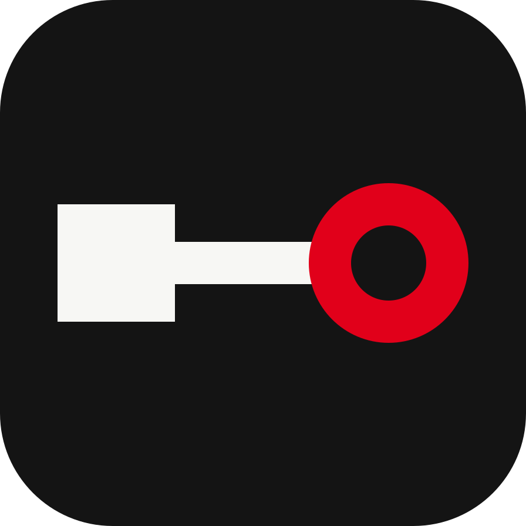

# Brand

Homeport stays on your machine and visits your servers. It never moves in. The identity is built to feel **steady**: calm, neutral and legible from across a room, with one red signal that you trust without thinking. The references are a railway station clock (neutral face, one loud red hand), maritime signal flags (flat colour, one exact meaning each) and Shaker joinery (nothing decorative that doesn't do a job). ADR 0007 records why it replaced the harbour identity.

Tagline: **Every Docker Engine, on one board.**

## Mark

 &nbsp; 

Three shapes, read left to right:

- **Square**: this machine, where Homeport runs.
- **Line**: the connection, over SSH, TLS, TCP or a local socket.
- **Hollow ring** in Signal red: a Host. It is hollow because nothing is installed on it.

Use the **mark** (ink tile) wherever the product is represented: the app icon, favicons, About, the welcome screen. Use the **glyph** (no tile) beside the wordmark and on light surfaces; the square and line take the text colour, the ring is always red. Don't recolour the ring, rotate the mark, outline it, add effects, or turn the ring into a clock face.

Minimum sizes: mark 16 px, lockup 16 px high. Keep clear space of at least the ring's diameter around it.

## Lockup

The glyph beside the word **Homeport** in Host Grotesk SemiBold (600), tracking −1 %. Capital H, as in all copy.

| File                                                                | Use                                               |
| ------------------------------------------------------------------- | ------------------------------------------------- |
| [`assets/brand/lockup-light.svg`](../assets/brand/lockup-light.svg) | Light backgrounds (glyph and wordmark in Ink)     |
| [`assets/brand/lockup-dark.svg`](../assets/brand/lockup-dark.svg)   | Dark backgrounds (glyph and wordmark in Paper)    |
| [`assets/brand/mark.svg`](../assets/brand/mark.svg)                 | The mark alone; also `public/favicon.svg`         |
| [`assets/brand/glyph.svg`](../assets/brand/glyph.svg)               | Tile-less glyph for light surfaces                |
| [`assets/app-icon.svg`](../assets/app-icon.svg)                     | Source of every app icon (1024 canvas, 64 margin) |

In the app, use `<LogoMark />` and `<Logo />` from `@/shared/ui`; they draw the same shapes inline.

The wordmark in the SVG lockups is outlined from Host Grotesk, so it renders without the font. Regenerate the platform icons and the website's images after changing the mark:

```sh
bunx tauri icon assets/app-icon.svg   # then delete src-tauri/icons/{android,ios}
cd website && bun scripts/brand-images.ts
```

## Colour

Three colours. Everything that isn't Ink or Paper is a status, and only one status is red.

| Name   | Light     | Dark      | Role                                                                   |
| ------ | --------- | --------- | ---------------------------------------------------------------------- |
| Ink    | `#141414` | `#141414` | Text, primary buttons, the board, dark surfaces. 17.2:1 on Paper       |
| Paper  | `#f7f7f4` | `#f7f7f4` | Surfaces, text on dark. Warm enough not to glare at 2 a.m.             |
| Signal | `#c8102e` | `#ff5c5c` | **One meaning: this needs you.** Errors, failures, destructive actions |
| Mark   | `#e1001a` |           | The ring in the mark only, fixed on both backgrounds (3:1 or more)     |

The UI tokens live in `src/shared/styles/global.css`. Buttons are Ink on light and Paper on dark (`--primary`); there is no accent colour for links, focus or selection, which use the text colour. Red is never decoration: not a brand moment, not a cursor, not a chart series, not a "New" badge.

Neutrals are warm greys: `#5c5c57` muted text (6.3:1 on Paper), `#a6a6a0` on dark (7.5:1).

### Status

Healthy is the default, so healthy gets no colour. Only what needs attention is coloured, and only what needs you is red. Every status is also a shape, so it reads in greyscale and for colour-blind eyes (`StatusDot`):

| Tone      | Shape and colour                      | Used for                                     |
| --------- | ------------------------------------- | -------------------------------------------- |
| `success` | ● Ink disc (`--success`)              | Running, connected, healthy                  |
| `muted`   | ○ grey ring                           | Stopped, exited, disabled                    |
| `info`    | ○ Ink ring                            | Connecting, not deployed                     |
| `warning` | ◆ amber diamond `#9a5b00` / `#f2a93b` | Starting, paused, restarting, a key to check |
| `danger`  | ● Signal red disc                     | Unhealthy, unreachable, refused, failed      |

There is deliberately no green. If testing with real users shows that "all ink" reads as "nothing is running", the fix is a muted green for `--success` only; red stays the only loud colour.

Charts are neutral: series are Ink or grey, and a second series in the same chart is dashed (`ChartSeries.dashed`), never a status colour.

Libraries that can't read CSS variables carry hex copies: `src/shared/ui/terminal/XTerm.tsx` (the 16 ANSI colours stay distinct because they belong to the programs that print them; red is Signal red) and `src/shared/ui/editor/editorTheme.ts` (keys in the text colour, values in two quiet hues, comments italic; red, amber and green never mean syntax).

## Shape

Flat surfaces, hairline borders, radius 4 px (`--radius: 0.25rem`). No gradients, glows, shadows for depth, blur or glass. Nothing slides or lifts on hover; the website fades sections in with opacity only, and not at all when the visitor prefers reduced motion.

## Type

Both are free to ship under the SIL Open Font License (`about.toml` accepts OFL-1.1).

- **Host Grotesk** (variable, 300–800; `@fontsource-variable/host-grotesk`) for the interface, headings and the wordmark. 700 for display headlines, 600 for titles and the wordmark, 500 for labels, 400 for body. A neo-grotesque with signage neutrality, not a geometric "tech" sans.
- **Fragment Mono** (400 and italic; `@fontsource/fragment-mono`) for anything a machine wrote or will read: IDs, paths, ports, commands, logs, terminals, compose files (`font-mono`). It is Helvetica-derived, so machine text and interface text feel like one voice. It has **one weight** on purpose: emphasis in machine text comes from colour or italic, never bold, and the app turns off faked bold (`font-synthesis-weight: none`, xterm's `fontWeightBold: 'normal'`).

Known weakness: Host Grotesk's hyphen is wide, so a name like `prod-eu-1` can read like `prod–eu–1` in the sans. Names that are machine identifiers (container names, image references) read better in Fragment Mono.

## Voice

Plain, specific, calm. Say what happened and what to do next; name things by the [glossary](../GLOSSARY.md) (Host, Engine, Stack, Managed Stack, External Stack, Adopt). British spelling (colour, licence). No exclamation marks.

Never: seamless, effortless, powerful, unleash, supercharge, next-gen, blazing fast, AI-powered, single pane of glass, game-changer, "for developers, by developers".

### Claims

Only claim what is true for every connection type, or say which one it's true for:

- **No agent and no web panel** on the server: true for all.
- **No extra open port**: true only for SSH. TLS and TCP need the Engine's API port (usually 2376 and 2375), which the user exposes. Never write "no open port" without saying "over SSH".
- **Nothing installed**: true. An SSH Host with Homeport's key adds one line to `authorized_keys`; say so where it matters.
- **Free, MIT, Windows, macOS and Linux**, **no account**, **no telemetry**: true.

## Never

Whales, anchors, ship's wheels, rope, knots, lighthouses, waves, sailors or any nautical kitsch; Docker blue (`#2496ED`) or anything that reads as an official Docker product; purple-to-blue gradients; glassmorphism; glowing green-on-black terminals; isometric server racks; tilted dashboard screenshots as a hero; stock photos of people at laptops; mascots; emoji.
